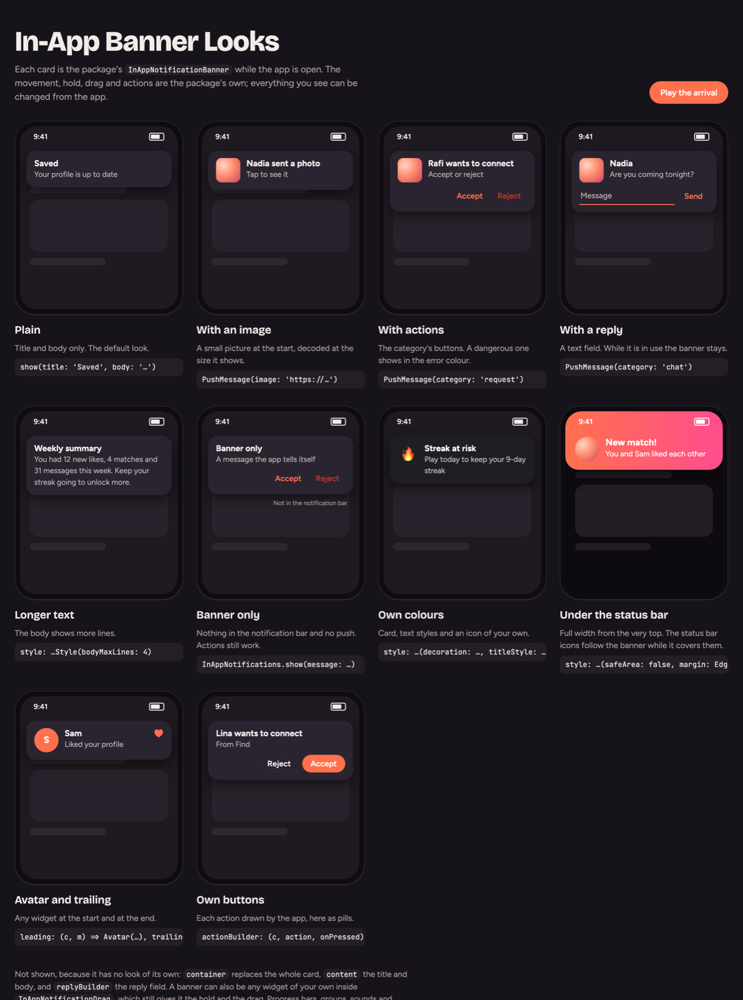
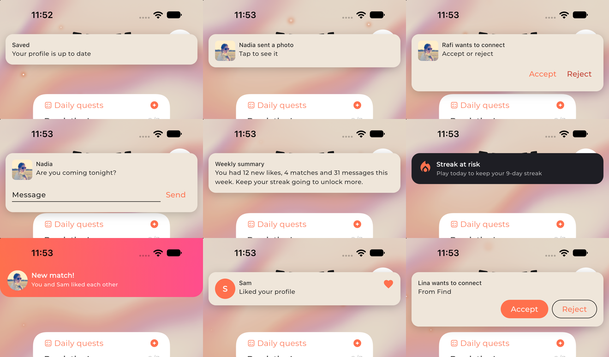

# in_app_notifications

Push notifications for any push service and backend: the phone's **token** kept on the signed-in account, a push
**shown while the app is open**, and the **page a tapped push opens**. It has no dependencies: the app gives the push
service, the display and the storage through three small delegates.

<p align="center">
  
</p>

<sub>Every look of the in-app banner, each with the call that makes it.
**[Open it live in your browser](https://raw.githack.com/Mohiuddin655-PUB/flutter_in_app_notifications/main/doc/banner_looks.html)**
and play its arrival (the page itself: [doc/banner_looks.html](doc/banner_looks.html)).</sub>

<p align="center">
  
</p>

<sub>The same looks in a real app (iPhone simulator): only the banner's style and builders change.</sub>

## What it does

- **Pushes and the phone's own notifications**, the same way: a token kept on the account, shown in the notification bar,
  scheduled, cancelled.
- **A banner inside the app** while it is open, moving as Discord's: it comes down fading in and growing, a finger holds
  it, a drag moves it exactly with the finger, a let-go carries it out from where it is or springs it back.
- **Actions and replies** (Accept, Reject, a typed reply) on the notification and on the banner, handled even when the
  app was closed.
- **Images, groups, sounds, badges, progress, urgent ones**, on Android and iOS.
- **Every visible part is yours**: a style for the look, and a builder for any part. The motion, hold, drag and
  actions stay the package's.
- **No dependencies**: the push service, the display and the storage are your delegates; the native setup comes with the
  package.

```dart
InAppNotifications.setup(
  messaging: FcmMessaging(),          // NotificationMessagingDelegate: Firebase Cloud Messaging, say
  display: LocalDisplay(),            // NotificationDisplayDelegate: a local notifications plugin, say
  tokens: FirestoreTokens(),          // TokenStoreDelegate: accounts/{uid}/devices/{token}, say
  onError: (error, stack, where) => crashlytics.recordError(error, stack, reason: where),
  unreachable: (error) => error is TimeoutException,
);
await InAppNotifications.init();      // at launch
InAppNotifications.start(uid);        // at sign-in, or a launch still signed in
await InAppNotifications.clear();     // before sign-out, while the account can still write

// With whileOpen: WhileOpen.banner, a notification while the app is open shows inside it. The
// package's banner does the work (actions, a reply field that holds it, tap, swipe); every visible part is the app's:
MaterialApp(
  builder: (context, child) => InAppNotificationGate(
    builder: (context, message, onOpen, onDismiss) => InAppNotificationBanner(
      message: message,
      onOpen: onOpen,
      onDismiss: onDismiss,
      style: InAppNotificationBannerStyle(
        decoration: BoxDecoration(color: myCard, borderRadius: BorderRadius.circular(20)),
        titleStyle: myTitle,
        bodyStyle: myBody,
        actionStyle: TextButton.styleFrom(foregroundColor: myAccent),
      ),
      leading: (context, message) => MyAvatar(message),         // optional: replace a part whole
      actionBuilder: (context, action, onPressed) => MyChip(action.title, onTap: onPressed),
    ),
    transitionBuilder: InAppNotificationBanner.slideTransition,
    child: child!,
  ),
);
// Or a banner entirely the app's own: any widget, with InAppNotifications.category(message.category) for its
// actions, InAppNotifications.answer(actionId, input:) to answer, and InAppNotifications.hold(true) while typing.

// Actions: each kind of notification names what it offers; every answer comes to onAction, in the background too.
InAppNotifications.setup(
  // ...
  categories: [
    NotificationCategory(id: 'chat', actions: [
      NotificationAction(id: 'reply', title: 'Reply', input: true, inputHint: 'Message', inputButton: 'Send'),
    ]),
    NotificationCategory(id: 'request', actions: [
      NotificationAction(id: 'accept', title: 'Accept'),
      NotificationAction(id: 'reject', title: 'Reject', destructive: true),
    ]),
  ],
  onAction: handleAction, // a top-level function: Future<void> handleAction(NotificationAnswer a) { a.actionId, a.input }
);
await InAppNotifications.notify(message: PushMessage(
  id: 'chat-42', title: 'Nadia', body: 'Are you coming?', category: 'chat', group: 'chat-42',
  image: 'https://…/photo.jpg', data: {'page': 'chats'},
));
// A push does the same through its data: {category, group, image, sound, badge, urgent, expanded} (NotificationKeys);
// on iOS also send aps.category for its actions, and add a Notification Service Extension for its image.

// The banner alone (nothing in the notification bar, no push): a message the app tells itself.
InAppNotifications.show(title: 'Saved', body: 'Your profile is up to date');
InAppNotifications.show(message: PushMessage(id: 'match-7', title: 'A match!', category: 'request', data: {'page': 'likes'}));

// A notification made on the phone: now, or scheduled.
await InAppNotifications.notify(id: 'streak', title: 'Keep your streak', data: {'page': 'home'});
await InAppNotifications.notify(id: 'reminder', title: 'See who liked you', at: DateTime(2026, 11, 10, 9), data: {'page': 'likes'});
await InAppNotifications.notify(id: 'break', title: 'Back to it?', after: const Duration(minutes: 30));
await InAppNotifications.cancel('reminder');

InAppNotifications.opened.addListener(() {
  final data = InAppNotifications.take(); // {'page': 'chats', ...}
});
```

## Just the banner (no setup)

The banner works on its own, without pushes, delegates, Firebase or any native setup. Two steps:

```dart
// 1. Wrap the app once.
MaterialApp(
  builder: (context, child) => InAppNotificationGate(
    edge: BannerEdge.top, // or BannerEdge.bottom
    builder: (context, message, onOpen, onDismiss) =>
        InAppNotificationBanner(message: message, onOpen: onOpen, onDismiss: onDismiss),
    child: child!,
  ),
);

// 2. Show a message from anywhere.
InAppNotifications.show(title: 'Saved', body: 'Your profile is up to date');
```

Optional, still without setup:

```dart
// Actions on the banner: name them once, then listen.
InAppNotifications.categories = [
  NotificationCategory(id: 'request', actions: [
    NotificationAction(id: 'accept', title: 'Accept'),
    NotificationAction(id: 'reject', title: 'Reject', destructive: true),
  ]),
];
InAppNotifications.show(message: PushMessage(id: 'req-1', title: 'Rafi wants to connect', category: 'request'));
InAppNotifications.actions.listen((a) => print(a.actionId)); // accept / reject, a.input for a reply
InAppNotifications.opened.addListener(() => print(InAppNotifications.take())); // a tapped banner's data
```

Everything the banner does (its motion, hold, drag, tap, actions and reply field) is the same with or without setup.
What needs `setup()` is only pushes, the notification bar, scheduling and the token.

## Toast, snackbar, popup: the same banner, by name

No new widgets: the gate keeps named looks of the same banner, and a message picks one by name.

```dart
InAppNotificationGate(
  looks: {
    'toast': BannerLook.toast(),       // small, dark, bottom, 2s, no actions
    'snackbar': BannerLook.snackbar(), // across the bottom, dark, with its actions, 4s
    'popup': BannerLook.popup(),       // in the middle, grows in, stays until tapped, answered or swiped
    'alert': BannerLook.popup(style: myAlertStyle).copyWith(stays: false, showFor: Duration(seconds: 8)),
    'mine': BannerLook(edge: BannerEdge.top, showFor: Duration(seconds: 3), builder: myBuilder), // the app's own
  },
  builder: ..., // the look when none is named, as before
  child: child!,
);

InAppNotifications.show(title: 'Copied', look: 'toast');
InAppNotifications.show(message: PushMessage(id: 'match', title: "It's a match!", category: 'request'), look: 'popup');
```

**Lanes: a toast beside the banner.** A look with its own `lane` (`BannerLook.toast()` has `lane: 'toast'`) shows in
that lane, beside the notification banner: a toast never replaces a banner showing, nor a banner a toast; each goes on
its own time, and only the banner is held (a reply typed, a finger on it). A message in the same lane replaces the one
there.

**This once:** `show()` takes `showFor`, `edge` and `padding` in place of its look's, for one message:

```dart
InAppNotifications.show(title: 'Press back again to leave', look: 'toast', showFor: const Duration(seconds: 3));
InAppNotifications.show(title: 'Copied', look: 'toast', edge: BannerEdge.top);
InAppNotifications.show(title: 'Blocked', look: 'toast', padding: const EdgeInsets.only(bottom: 120));
```

A push or a notification made on the phone picks one with `look` in its data (`NotificationKeys.look`), while the app
is open. Each value a look leaves out (its edge, place, motion, time, builder) is the gate's own; an unknown name shows
the gate's own look. The ready ones take a `style` (`InAppNotificationBannerStyle`) to look as the app's design does.

## While the app is open

`setup(whileOpen: ...)` says where a push or a notification made on the phone shows while the app is open. In the
background or closed, the notification bar shows it every time, and `show()` always uses the banner.

| `WhileOpen` | While the app is open | `show()` |
| --- | --- | --- |
| `bar` (default) | In the notification bar | Banner |
| `banner` | Banner, and quietly in the notification bar | Banner |
| `bannerOnly` | Only the banner | Banner |

The banner shows at the top by default; `InAppNotificationGate(edge: BannerEdge.bottom)` puts it at the bottom: it
comes up from there, and is swiped down to go.

## Setup

1. [App setup](doc/app_setup.md): the dependencies, the three delegates (FCM, flutter_local_notifications, Firestore),
   `setup`, `start` and `clear`, the permission, opening the right page, the in-app banner, and notifications made on
   the phone.
2. [Android setup](doc/android_setup.md): Firebase, desugaring, the manifest (permissions, the scheduled-notification
   receivers, the default channel and icon), and how Android behaves when testing.
3. [iOS setup](doc/ios_setup.md): the APNs key in Firebase, Push Notifications and Background Modes, the AppDelegate,
   which plugins not to add, and testing on a simulator.

### Native checklist

The package is a plugin: it brings its own native setup, so the app adds **nothing for it**:

- Android: with flutter_local_notifications in the app, the `POST_NOTIFICATIONS` and `RECEIVE_BOOT_COMPLETED`
  permissions and that plugin's receivers come in through the package's manifest (an app without it gets none).
- iOS: the package answers how a notification shows while the app is open (a push as Firebase's options say, kept in
  the list when the app shows its own banner; one made on the phone as it asks), and passes everything else on.

What only the app can do, because no package can. **Required** is needed for pushes to work at all; **For …** only
when the app uses that feature:

| Need | Where | What |
| --- | --- | --- |
| Required | `android/app/google-services.json`, `ios/Runner/GoogleService-Info.plist` | the app's Firebase config |
| Required | `android/app/build.gradle.kts` | `isCoreLibraryDesugaringEnabled = true` and `coreLibraryDesugaring("com.android.tools:desugar_jdk_libs:2.1.5")` (flutter_local_notifications needs it) |
| Required | Firebase console › Cloud Messaging | the APNs authentication key (`.p8`), Key ID and Team ID |
| Required | Xcode › Signing & Capabilities | Push Notifications, and Background Modes › Remote notifications |
| Required | `ios/Runner/AppDelegate.swift` | `UNUserNotificationCenter.current().delegate = self` before `super.application(...)` (so taps reach the plugins) |
| Required | Pubspec | no plugin that takes the notification delegate for every notification (`awesome_notifications`) |
| Recommended | `AndroidManifest.xml` | FCM's `default_notification_channel_id`, `default_notification_icon`, `default_notification_color` (otherwise a system-shown push uses Android's defaults) |
| Recommended | `res/drawable*/ic_stat.png`, `res/values/colors.xml` | a white-on-transparent small icon and its colour (otherwise the app icon, shown as a grey square) |
| For push images on iOS | Xcode + `ios/Podfile` | a `NotificationService` extension of one line (`class NotificationService: InAppNotificationService {}`) and the `InAppNotificationsService` pod on it (ios_setup.md §4) |
| For time-sensitive on iOS | Xcode › Signing & Capabilities | Time Sensitive Notifications (`urgent: true`; without it iOS shows it as active) |

Each line is explained in the platform guide.

## How it works

- **Token**: asked at `start`, saved through `TokenStoreDelegate.save` only when it differs from the copy last saved on
  the phone (`saved` / `remember`), so a launch writes nothing. A refreshed token is saved and the old one removed.
  `clear` removes it from the account and lets it go (`forgetToken`), so pushes to it stop even when the removal
  couldn't reach the server; it also drops a tapped push not yet taken and every push still shown
  (`NotificationDisplayDelegate.clearShown`), so none opens a page for the next account.
- **Shown while open**: each push from `NotificationMessagingDelegate.received` with a title or a body goes to
  `NotificationDisplayDelegate.show` (which does nothing where the platform shows it itself, as iOS does).
- **While the app is open, everything the same way**: with `inApp`, a push and a notification made on the phone both
  show inside the app and go into the notification bar quietly (`NotificationDisplayDelegate.keep` / `notify(quiet:)`);
  a scheduled one whose time comes while the app is open does too (`ScheduleStoreDelegate`: timers while open, the
  phone's alarms once hidden).
- **Inside the app instead**: with `setup(whileOpen: WhileOpen.banner)` (or `bannerOnly`), such a push goes to
  `InAppNotifications.inApp` (the newest replaces the one before) and not to the notification bar; the app shows it
  (a banner at its top, say) and calls `open()` when it is tapped or `dismiss()` when it goes. In the background or
  closed, the system shows it in the notification bar either way.
- **Tapped**: a push tapped in the background (`NotificationMessagingDelegate.tapped`), one that started the app (`initial`), and
  one shown while open (`NotificationDisplayDelegate.tapped` / `initial`) all put their data in `opened`, which waits until the app
  is ready to `take` it.
- **Errors**: every delegate call is caught; `onError` gets it unless `unreachable` says it was only offline.

## Server side

Send to the tokens kept on the account, with the data your app reads in `opened` (a page, an id). A token the push
service says is no longer registered can be deleted there.
