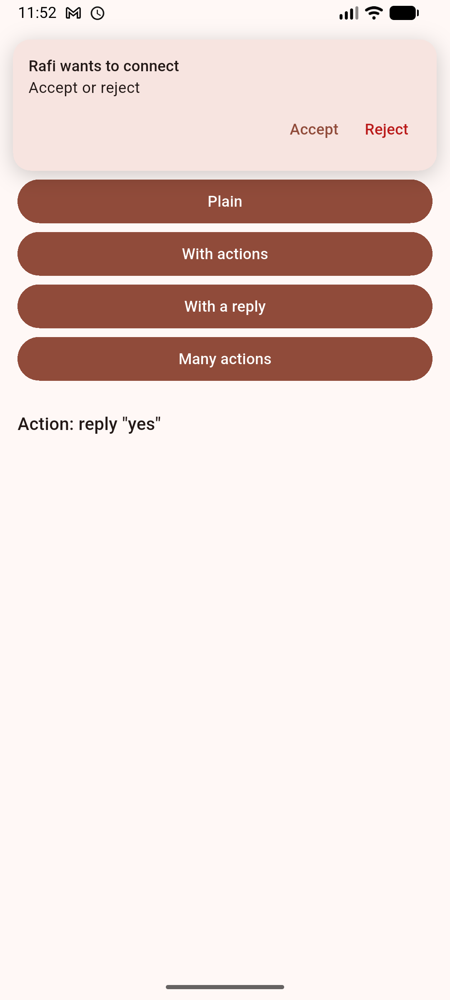

# in_app_notifications

Push notifications for any push service and backend: the phone's **token** kept on the signed-in account, a push
**shown while the app is open**, and the **page a tapped push opens**. It has no dependencies: the app gives the push
service, the display and the storage through small delegates.

  

An in-app notification, with its actions (the example, Android emulator).

## What it does

- **Pushes and the phone's own notifications**, the same way: a token kept on the account, shown in the notification
  bar, scheduled, cancelled.
- **Inside the app, in the app's own design**: `InAppNotificationHost` says when it shows, how long it stays (with the
  time left, for a progress bar) and how it comes and goes; the app's builder draws it from its data, a look picking
  its design.
- **Actions and replies** (Accept, Reject, a typed reply) on the notification and inside the app, handled even when
  the app was closed.
- **Images, groups, sounds, badges, progress, urgent ones**, on Android and iOS.
- **Only notifications**: toasts, popups and other overlays are the app's.

## Use it

1. **[Setup, A to Z](doc/setup.md)**: everything an app does, step by step, in code.
2. [Usage](doc/usage.md): each step explained.
3. [Android setup](doc/android_setup.md): Firebase, desugaring, the manifest, and how Android behaves when testing.
4. [iOS setup](doc/ios_setup.md): the APNs key, Push Notifications and Background Modes, the AppDelegate, a push's
   image, and how iOS behaves when testing.
5. [In-app notification setup](doc/in_app_notification_setup.md): showing it inside the app.
6. [Server setup](doc/server_setup.md): the key, and sending a push to an account's phones.

Ready code to copy: [push_example](push_example/lib) (Firebase Cloud Messaging, flutter_local_notifications,
Firestore, shared_preferences). The [example](example/lib) shows an in-app notification on its own, with actions and a
reply.
